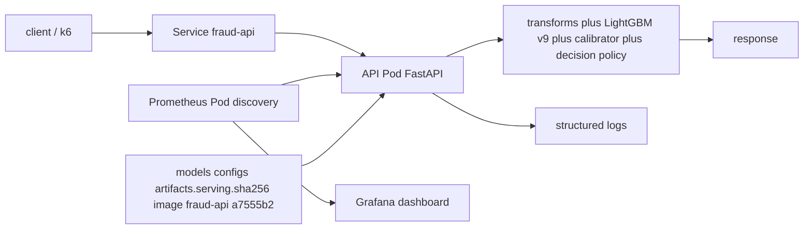

# Portfolio case study

This is a local production-style ML learning project. Traffic is synthetic, incidents were controlled drills, labels in the batch demo are simulated, and no real production reliability or fraud-detection performance has been demonstrated.

## Problem

The service scores one e-commerce transaction at a time and returns a fraud probability plus an action. The locked model is LightGBM v9 on dataset 5 [docs/release_baseline.md]. On the historical test split, offline test AUC-PR is 0.5952463633992758 [models/lgbm_v9_optuna_tuning_metrics.json], with 464 features [models/lgbm_v9_optuna_tuning_metrics.json]. That figure is an offline metric on a past split. It is not a measure of the running service.

## Architecture

The image in the diagram is `fraud-api:a7555b2` [deploy/k8s/local/deployment.yaml], and the model is v9 [docs/release_baseline.md]. The API pod loads `models/`, `configs/`, and `artifacts.serving.sha256` at startup and checks those checksums before it serves [docs/artifacts.md]. Prometheus discovers the pod and Grafana reads Prometheus. k6 sends synthetic posts to the Service.

## Frozen release

The cluster manifest pins image `fraud-api:a7555b2` [deploy/k8s/local/deployment.yaml], one replica [deploy/k8s/local/deployment.yaml], requests 250m CPU and 768Mi memory, limits 500m CPU and 1Gi memory [deploy/k8s/local/deployment.yaml]. The recovery baseline records that tag, code commit `a7555b2`, and golden `fraud_probability` 0.005580357142857143 with action `approve` [docs/release_baseline.md]. The allowed score difference is an absolute 1e-6, and that tolerance is still proposed, pending mentor approval [docs/release_baseline.md]. Deployment revision before any fault was 6 [docs/release_baseline.md]. `UVICORN_WORKERS` is 1 [deploy/k8s/local/configmap.yaml]. The container command does not read that value, so the pod is one process [docs/metrics.md].

## Monitoring

`GET /metrics` exposes request counters, a latency histogram, prediction counts by action, and model gauges [docs/metrics.md]. In-cluster Prometheus scrapes the pod, and Grafana is the local dashboard [docs/operations.md]. Thresholds and alerting are not set up [docs/operations.md]. Probes are counted on their own routes. Prediction panels filter `route="/predict"`, so an unmatched 4xx does not move those panels [docs/metrics.md].

## Load experiment

k6 ran inside the same kind node as the API. The compared runs are in [docs/load_test.md](load_test.md). At 1 user and a 500m limit the measured rate was 6.883 req/s over 413 requests, p50 123.6 ms, peak CPU 0.501 cores, peak RSS 320.1 MiB [docs/load_test.md]. At 5 users and 500m the rate was 4.533 req/s and p50 1102.3 ms [docs/load_test.md]. Raising the limit to 1000m at 5 users produced 9.983 req/s and p50 496.3 ms [docs/load_test.md]. HTTP failures and semantic failures were 0 on every listed run [docs/load_test.md]. The findings round that 5-user comparison as 4.5 req/s at 500m and 10.0 req/s at 1000m [docs/load_test.md]. Peak CPU sat on the limit in each measured run [docs/load_test.md].

The 24 synthetic payloads are mostly `review`: approve 3, step_up 0, review 21, decline 0 [docs/model_monitoring.md].

## Recovery drills

### Release

The drill patched only the live readiness path. `kubectl rollout status` was bounded at 90s [scripts/drills/release_incident.sh] and exited 1 [docs/evidence/phase11/release_incident.log]. The new pod was not ready. Its readiness probe returned HTTP 404 on an unmatched route [docs/evidence/phase11/release_incident.log]. Endpoints stayed on the old pod, and the golden request id was in that pod's logs and absent from the new pod [docs/evidence/phase11/release_incident.log]. The Service golden score during the fault was still 0.005580357142857143 [docs/evidence/phase11/release_incident.log].

Restore was `kubectl apply` of the committed manifest, then a rollout status wait [docs/release_baseline.md]. After that, the image was `fraud-api:a7555b2`, `kubectl diff` exited 0, the golden score matched 0.005580357142857143, and the log says `RECOVERY VERIFIED` [docs/evidence/phase11/release_incident.log]. The revision in that log moved from 8 to 10 [docs/evidence/phase11/release_incident.log]. The recorded total from fault injection to that check was 94 seconds [docs/evidence/phase11/release_incident.log]. That total is the 90s wait [scripts/drills/release_incident.sh] plus the checks, not a measured repair time.

The user-facing prediction dashboard stayed normal through a later rerun of the same stuck rollout: volume rose with the background traffic, and the error-ratio panels did not show the probe 404s [docs/evidence/phase11/release_incident.log]. That is why a green dashboard is not a rollout-health signal. The window is [docs/evidence/phase11/release_incident_dashboard_window.png](evidence/phase11/release_incident_dashboard_window.png).

### Data

3 of 24 batch rows were missing `TransactionAmt` [docs/evidence/phase11/data_incident_rerun.txt]. Before the fix, the captured error was `POST /predict failed for syn-003: HTTP 422` [docs/evidence/phase11/part1_invalid_batch.stderr], and the captured stdout was empty [docs/evidence/phase11/part1_invalid_batch.stdout]. The drift path scored 24 rows and printed overall status CRITICAL [docs/evidence/phase11/part1_drift.stdout]. `schema_missing_columns` was critical at observed 438 [docs/evidence/phase11/part1_drift.stdout]. `missingness_rate_change` was a warning at observed 1.0 against a threshold of 0.05 [docs/evidence/phase11/part1_drift.stdout], and that stdout does not name `TransactionAmt`.

After the batch tool checked the whole file against `/openapi.json` before any post, the invalid run printed `batch rejected: 3 of 24 rows invalid` and exited 2 [docs/evidence/phase11/data_incident_rerun.txt]. `/predict` counters stayed at 2xx 9.0, 4xx 1.0, and 5xx 0.0 [docs/evidence/phase11/data_incident_rerun.txt]. The valid rerun exited 0, scored 24 rows, and matched the earlier report with max absolute `fraud_probability` difference 0.0 [docs/evidence/phase11/data_incident_rerun.txt]. The golden score afterward was 0.005580357142857143 with absolute difference 0.0 [docs/evidence/phase11/data_incident_rerun.txt].

The batch demo's labels are simulated. 10 of 24 rows match the invented file, and performance is not computed [docs/model_monitoring.md].

## Tradeoffs

The main tradeoff is one uvicorn process at a 500m CPU limit [deploy/k8s/local/deployment.yaml].

(a) One process at 500m keeps the Prometheus metrics inside that process and holds the baseline RSS to 320.1 MiB [docs/load_test.md]. The same runs show the process is CPU-bound: peak CPU was 0.501 cores against the 500m limit [docs/load_test.md]. Five users at that limit produced 4.533 req/s, which the findings state as 4.5 req/s, and the 1000m run produced 9.983 req/s, which the findings state as 10.0 req/s [docs/load_test.md]. Adding workers would split those counters per process and would need Prometheus multiprocess mode [docs/metrics.md].

(b) Model artifacts are copied into the image and checked against `artifacts.serving.sha256` before the model loads [docs/artifacts.md]. That makes a running pod match the checksummed files. The image is about 426 MB [docs/kubernetes_runbook.md], and any artifact change means a new image.

(c) The kind cluster is one node, `fraud-local-control-plane`, and that node runs k6, the API, Prometheus, and Grafana [docs/load_test.md]. The setup is cheap to recreate from the runbooks. The rates above are laptop measurements, and they do not transfer to a production cluster.

(d) The payloads are the 24 invented rows in the load file [docs/model_monitoring.md]. Nothing private is in the traffic. They are out of distribution: review is 21 of those 24 actions [docs/model_monitoring.md]. The action mix and the scores do not describe real transactions.

## What I would change in a company environment

Alert on rollout health, including a Deployment that is stuck or not progressing. The release drill left the old pod serving, the prediction error ratios did not move, and the dashboard looked normal while the rollout had already failed its bounded wait.

Build the image in CI, push it to a registry, and deploy by digest. The local cluster is loaded with `kind load` and pinned by the tag `fraud-api:a7555b2` [docs/kubernetes_runbook.md]. A digest in the manifest would be the identity a registry deploy can check.

## Limitations

Traffic is synthetic [docs/load_test.md]. The Deployment is a single replica [deploy/k8s/local/deployment.yaml]. Alerting is not set up [docs/operations.md]. There are no real labels. The batch demo uses simulated labels for 10 of 24 rows [docs/model_monitoring.md]. Local Compose builds still use the tag `fraud-api:latest` [docker-compose.yml], while the cluster manifest pins `fraud-api:a7555b2` [deploy/k8s/local/deployment.yaml]. The score tolerance of 1e-6 is proposed and pending mentor approval [docs/release_baseline.md]. The artifact handoff is written in [docs/artifacts.md](artifacts.md) and has not had an independent check.
